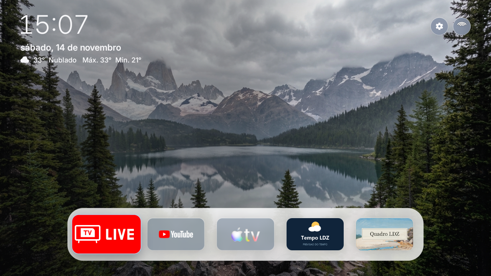
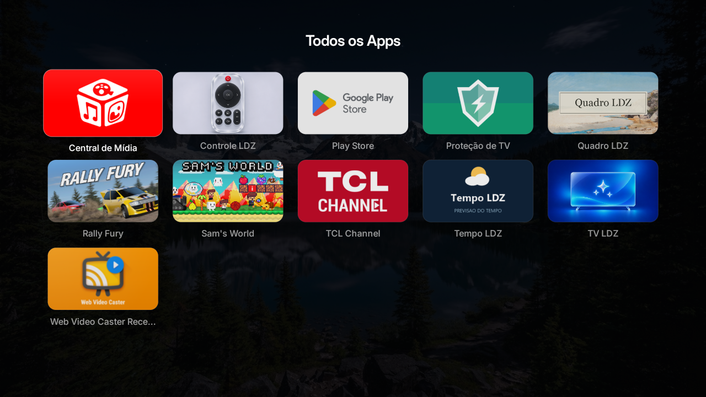
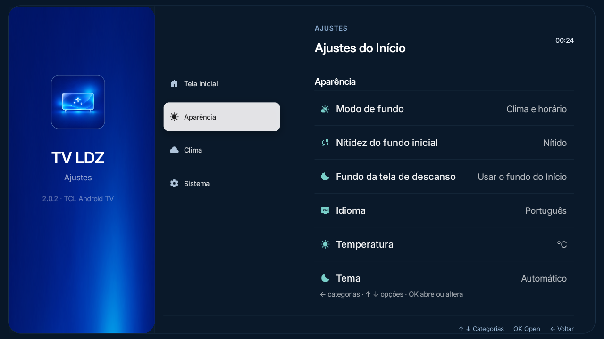
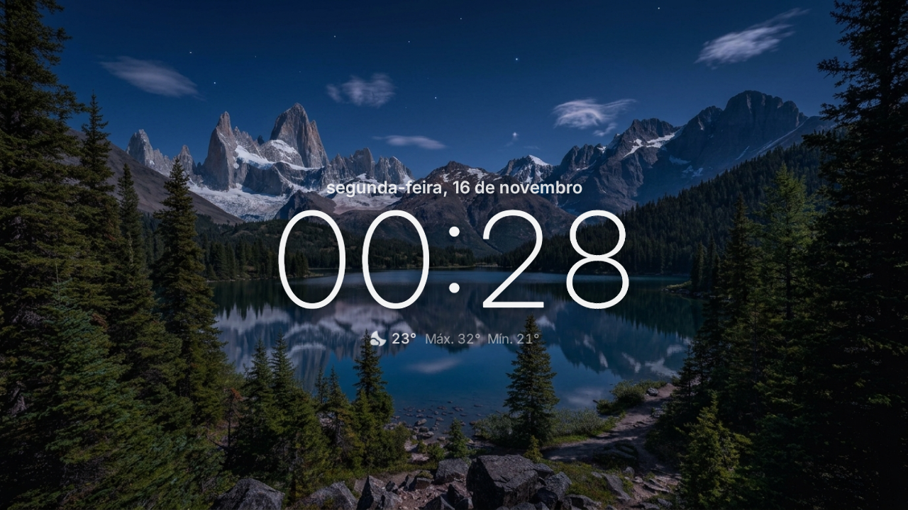
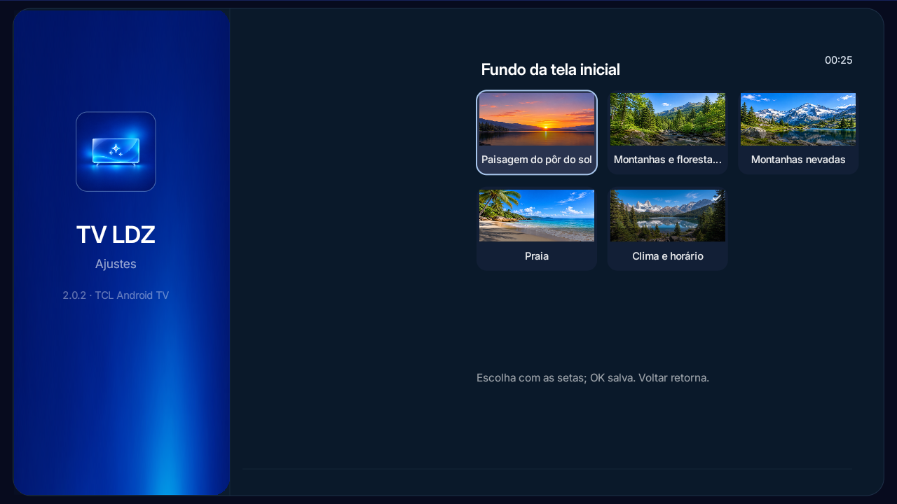
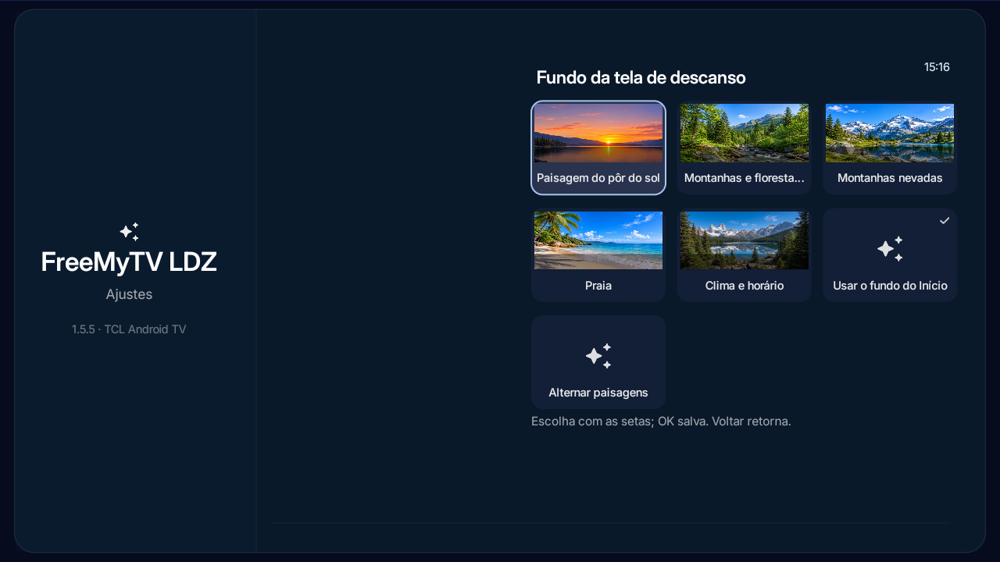

# TV LDZ

**TV LDZ** é um launcher personalizado para Google TV e Android TV, inspirado no projeto [Free My TV de simbasjungles](https://github.com/simbasjungles/free-my-tv). Esta compilação é mantida separadamente por LuDeZam e não é afiliada, patrocinada ou endossada pelos mantenedores do projeto original.

> O nome deste projeto é TV LDZ. Free My TV é o projeto original que serviu de inspiração; os créditos e a licença do código original estão preservados nesta distribuição.

## Capturas de tela

Capturas reais da versão 2.0.2 em uma TV TCL com Android TV. A versão 2.0.5 mantém o novo painel lateral dos Ajustes e restaura as opções de fundo. Use as setas do controle para navegar pelas categorias do menu.

<table>
  <tr>
    <td align="center"><strong>Tela inicial</strong><br></td>
    <td align="center"><strong>Todos os apps</strong><br></td>
  </tr>
  <tr>
    <td align="center"><strong>Ajustes · Aparência</strong><br></td>
    <td align="center"><strong>Tela de descanso</strong><br></td>
  </tr>
  <tr>
    <td align="center"><strong>Escolha do fundo da home</strong><br></td>
    <td align="center"><strong>Escolha do fundo do descanso</strong><br></td>
  </tr>
</table>

## Opções de tela de fundo e de descanso

As escolhas do fundo da **Tela inicial** e da **Tela de descanso** são independentes:

- **Tela inicial:** Paisagem do pôr do sol, Montanhas e florestas verdes, Montanhas nevadas, Praia ou Clima e horário.
- **Tela de descanso:** oferece as mesmas cinco opções, além de **Usar o fundo do Início** e **Alternar paisagens**. A primeira acompanha a escolha da Tela inicial; a segunda alterna entre as quatro paisagens a cada 30 segundos.

Em **Clima e horário**, a ilustração acompanha a condição do tempo e o período do dia. Há imagens próprias para os 15 minutos antes e depois do nascer e do pôr do sol. As paisagens ficam incluídas no APK; a opção de clima precisa dos dados meteorológicos para acompanhar o tempo atual.

## Baixar

- **Versão publicada atualmente: 2.0.5.** Baixe o APK nos [Releases](https://github.com/ludezam/TV-LDZ/releases/latest).
- **Tempo LDZ:** [projeto, código e releases](https://github.com/ludezam/tempoLDZ), distribuído separadamente.
- **Quadro LDZ:** [projeto, instruções e releases](https://github.com/ludezam/Quadro-LDZ), distribuído separadamente.

O lançamento atual de TV LDZ contém apenas este aplicativo. Tempo LDZ e Quadro LDZ não estão incluídos no APK nem no pacote da release.

## Versão publicada: 2.0.5

- Direciona o atualizador integrado para o repositório renomeado [ludezam/TV-LDZ](https://github.com/ludezam/TV-LDZ), mantendo a checagem de integridade e assinatura.
- Mantém as opções de fundo inicial, tela de descanso e nitidez restauradas na versão 2.0.4.
- Mantém o painel lateral dos Ajustes como superfície contínua de vidro azul.

## Versão anterior: 2.0.4

- Restaura as opções de fundo da **Tela inicial** e da **Tela de descanso**, além do ajuste de nitidez.
- O painel lateral dos Ajustes agora é uma superfície contínua de vidro azul, com curvas e reflexos, e uma TV vetorial luminosa com as três estrelas.
- O card do TV LDZ continua usando a arte azul até as bordas em **Todos os apps**.
- As opções de fundo inicial e de descanso são independentes e podem ser escolhidas por miniaturas.
- Menu de configurações organizado nas categorias **Tela inicial**, **Aparência**, **Clima** e **Sistema**.
- A tela de descanso mostra hora, data e clima sobre a paisagem escolhida.
- O menu de contexto da prateleira permite mover, desafixar, desinstalar ou gerenciar aplicativos.
- Em Aparência, o fundo inicial pode ser exibido desfocado ou nítido.
- O menu **Atualizações** consulta as releases de TV LDZ; o Android pede confirmação ao instalar cada atualização.
- Compatível com Android TV 9 ou superior; testado em TVs TCL com Android 9, Android 11 e Android 12.

## Compatibilidade

O pacote mantém o identificador Android `io.freemytv` para permitir atualização das versões LDZ anteriores. O projeto é inspirado no Free My TV original e mantido separadamente; os créditos e a licença do projeto original continuam incluídos.

## Instalar ou atualizar

O APK é destinado a TVs Android/Google TV. Com depuração ADB ativada e a TV e o computador na mesma rede:

```powershell
adb connect IP_DA_TV:5555
adb install -r FreeMyTV-LDZ.apk
```

Na primeira instalação, selecione **TV LDZ** no menu de apps e escolha **TV LDZ** em **Tela inicial**. Se o Android perguntar, permita a depuração USB.

As versões LDZ são assinadas com uma chave privada de distribuição que não está neste repositório. Todas as futuras versões devem usar a mesma chave para que o Android aceite a atualização. Nunca envie o arquivo `.keystore` ou a chave privada ao GitHub.

## Compilar o código

O build Android usa JDK 17, Android SDK com `platforms;android-34` e `build-tools;34.0.0`. Em Bash, na raiz do repositório:

```bash
./build.sh --generic --custom
```

O comando cria um APK genérico personalizado em `FreeMyTV-LDZ.apk`. Para publicar uma atualização pelo menu, anexe-o à release com esse nome exato e assine-o com a chave privada de distribuição LDZ. **Nunca envie arquivos `.keystore` ou chaves privadas ao GitHub.**

## Créditos e licenças

- **Free My TV**, de [simbasjungles](https://github.com/simbasjungles/free-my-tv): código sob MIT. O aviso e a licença originais estão em [`LICENSE`](LICENSE).
- **Paisagens, ilustrações do clima e identidade visual:** criadas com IA pelo autor desta versão para TV LDZ. Consulte [`THIRD_PARTY_NOTICES.md`](THIRD_PARTY_NOTICES.md) para os avisos de terceiros.
- **Inter:** licença SIL Open Font License 1.1 em `app/assets/fonts/OFL.txt`.
- **Material Symbols:** licença Apache 2.0 em `app/assets/symbols/LICENSE-material-symbols.txt`.

Veja também os projetos independentes [Tempo LDZ](https://github.com/ludezam/tempoLDZ) e [Quadro LDZ](https://github.com/ludezam/Quadro-LDZ).

## Projetos relacionados

- [FreeMyProjector LDZ](https://github.com/ludezam/FreeMyProjector-LDZ) — home personalizada para projetores Android.
- [Controle LDZ](https://github.com/ludezam/Controle-LDZ) — controle remoto local por Wi-Fi para Android TV e projetores Android.


