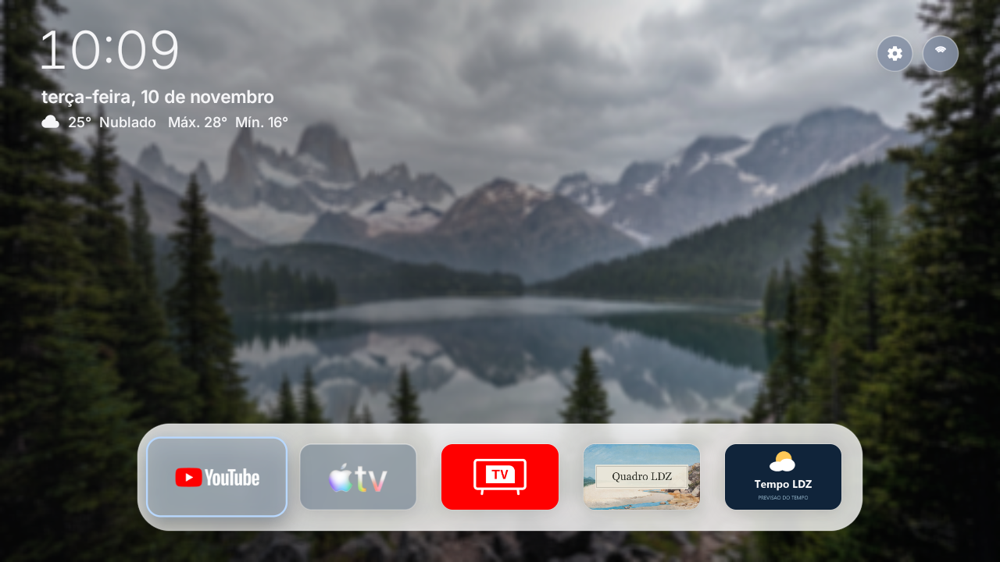
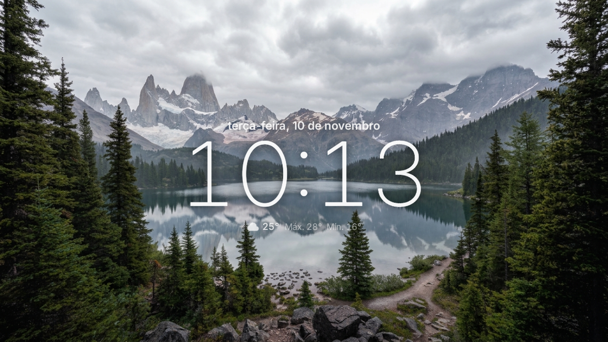
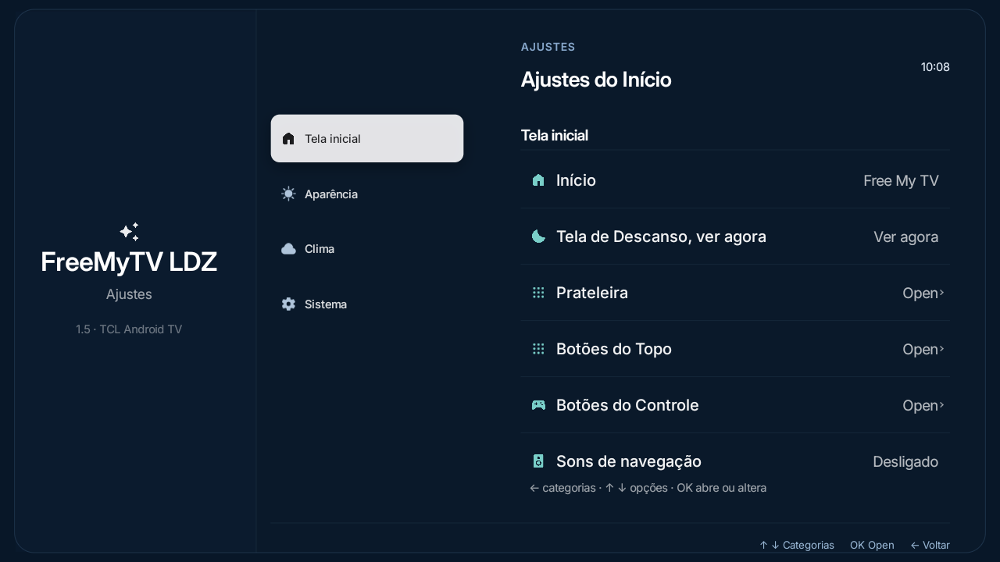
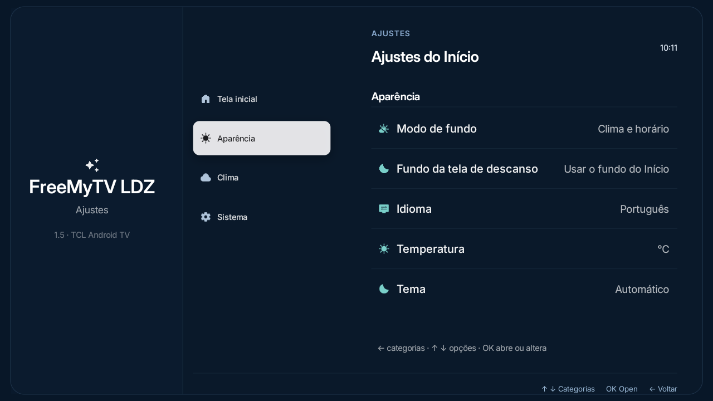
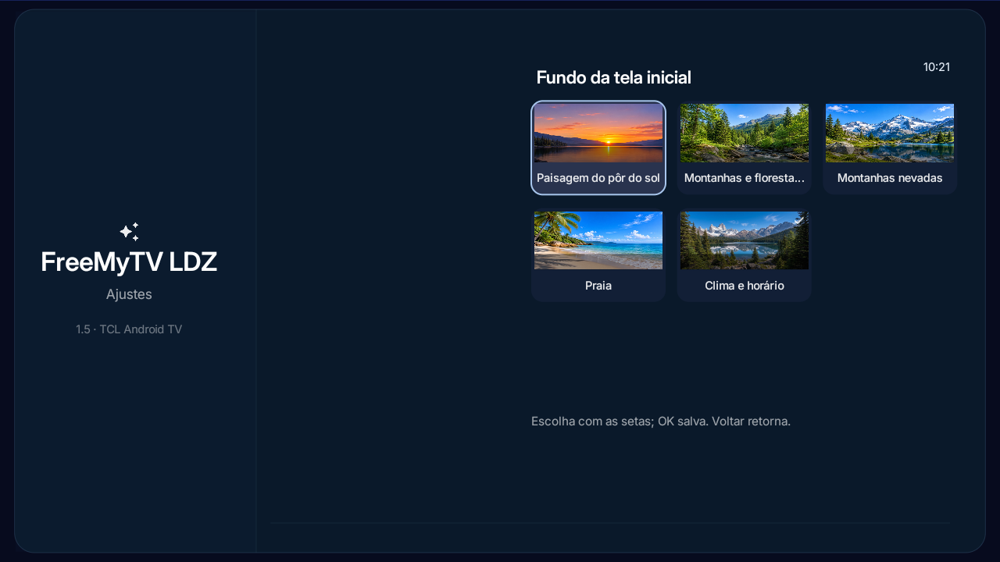
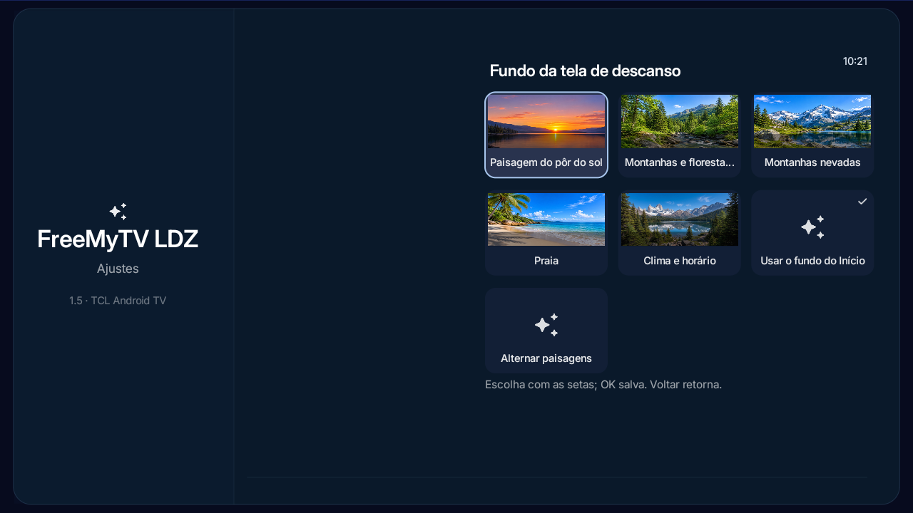

# FreeMyTV LDZ

**Uma versão personalizada e não oficial do Free My TV**, um launcher para Google TV e Android TV. O projeto original de [simbasjungles/free-my-tv](https://github.com/simbasjungles/free-my-tv) foi a inspiração e a base do código. Este projeto é mantido separadamente por LuDeZam e não é afiliado, patrocinado ou endossado pelos mantenedores do original.

> Free My TV é o projeto original de simbasjungles. “FreeMyTV LDZ” identifica esta compilação comunitária personalizada; não reivindicamos a marca ou o logotipo do projeto original.

## Capturas de tela

Capturas reais da versão 1.5 em uma TV TCL com Android TV. Use as setas do controle para navegar pelas categorias do menu.

<table>
  <tr>
    <td align="center"><strong>Tela inicial</strong><br></td>
    <td align="center"><strong>Tela de descanso</strong><br></td>
  </tr>
  <tr>
    <td align="center"><strong>Ajustes · Tela inicial</strong><br></td>
    <td align="center"><strong>Ajustes · Aparência</strong><br></td>
  </tr>
  <tr>
    <td align="center"><strong>Escolha do fundo da home</strong><br></td>
    <td align="center"><strong>Escolha do fundo do descanso</strong><br></td>
  </tr>
</table>

## Opções de tela de fundo e de descanso

As escolhas do fundo da **Tela inicial** e da **Tela de descanso** são independentes:

- **Tela inicial:** Paisagem do pôr do sol, Montanhas e florestas verdes, Montanhas nevadas, Praia ou Clima e horário.
- **Tela de descanso:** oferece as mesmas cinco opções, além de **Usar o fundo do Início** e **Alternar paisagens**. A primeira acompanha a escolha da Tela inicial; a segunda alterna entre as quatro paisagens a cada 30 segundos.

Em **Clima e horário**, a ilustração acompanha a condição do tempo e o período do dia. Há imagens próprias para os 15 minutos antes e depois do nascer e do pôr do sol. As paisagens ficam incluídas no APK; a opção de clima precisa dos dados meteorológicos para acompanhar o tempo atual.

## Baixar

- **FreeMyTV LDZ 1.5.3:** baixe `FreeMyTV.apk` nos [Releases](https://github.com/ludezam/FreeMyTV-LDZ/releases/latest).
- **Pacote com os três apps:** baixe `LDZ-TV-Apps.zip` nos Releases. Ele contém FreeMyTV LDZ, Tempo LDZ e Quadro LDZ como APKs independentes.
- Tempo LDZ: [projeto e código](https://github.com/ludezam/tempoLDZ).
- Quadro LDZ: [projeto, instruções e releases](https://github.com/ludezam/Quadro-LDZ).

O pacote não combina os aplicativos em um só: instale somente os APKs que quiser usar. Tempo 1.4 e Quadro 0.3.0 são builds de teste; consulte os repositórios de cada app para as limitações e instruções específicas.

## O que muda nesta versão

- O menu **Atualizações** consulta as releases do FreeMyTV LDZ. Instale manualmente a versão 1.5.3 uma vez; versões posteriores poderão ser encontradas pelo próprio menu.
- A instalação de cada atualização continua dependendo da confirmação do Android.
- Em Aparência, o fundo inicial pode ser alternado entre desfocado e nítido.
- Menu de configurações reorganizado nas categorias **Tela inicial**, **Aparência**, **Clima** e **Sistema**.
- Relógio fixo no topo da tela inicial.
- Remoção das opções Destaques, Widget tocando agora e Minhas fotos.
- Remoção do ícone decorativo de Wi‑Fi na tela de ajustes.
- Fundos de paisagem e ilustrações do clima incluídos no APK e disponíveis offline.
- Compatível com Android TV 9 ou superior; testado em TVs TCL com Android 9 e Android 11.

## Instalar ou atualizar

O APK é destinado a TVs Android/Google TV. Com depuração ADB ativada e a TV e o computador na mesma rede:

```powershell
adb connect IP_DA_TV:5555
adb install -r FreeMyTV.apk
```

Na primeira instalação, selecione FreeMyTV LDZ no menu de apps e escolha **Free My TV** em **Tela inicial**. Se o Android perguntar, permita a depuração USB.

As versões LDZ são assinadas com uma chave privada de distribuição que não está neste repositório. Todas as futuras versões devem usar a mesma chave para que o Android aceite a atualização. Nunca envie o arquivo `.keystore` ou a chave privada ao GitHub.

## Compilar o código

O build Android usa JDK 17, Android SDK com `platforms;android-34` e `build-tools;34.0.0`. Em Bash, na raiz do repositório:

```bash
./build.sh --generic --custom
```

O comando cria um APK genérico personalizado em `FreeMyTV.apk`. Para publicar uma atualização pelo menu, anexe-o à release com esse nome exato e assine-o com a chave privada de distribuição LDZ. **Nunca envie arquivos `.keystore` ou chaves privadas ao GitHub.**

## Créditos e licenças

- **Free My TV**, de [simbasjungles](https://github.com/simbasjungles/free-my-tv): código sob MIT. O aviso e a licença originais estão em [`LICENSE`](LICENSE).
- **Paisagens e ilustrações do clima:** geradas com IA pelo autor desta versão para o FreeMyTV LDZ. Consulte [`THIRD_PARTY_NOTICES.md`](THIRD_PARTY_NOTICES.md) para o escopo das permissões dos recursos.
- **Inter:** licença SIL Open Font License 1.1 em `app/assets/fonts/OFL.txt`.
- **Material Symbols:** licença Apache 2.0 em `app/assets/symbols/LICENSE-material-symbols.txt`.

Veja também os projetos independentes [Tempo LDZ](https://github.com/ludezam/tempoLDZ) e [Quadro LDZ](https://github.com/ludezam/Quadro-LDZ).
